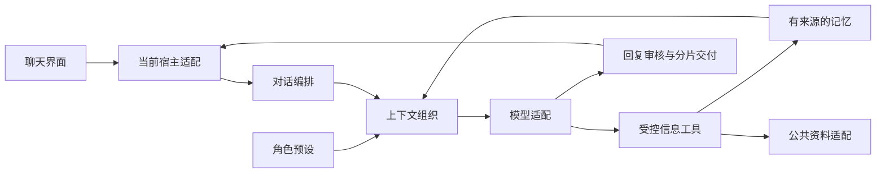

# 架构与职责

项目采用单仓、模块化单体。后端拥有对话与持久化状态，界面和外部服务通过明确接口参与。

图中表示职责与主要数据关系，不要求每条消息走遍所有分支。

| 位置 | 职责 |
|---|---|
| `text/` | 当前文本入口、对话编排、上下文装配、角色输入与运行策略 |
| `cognition/` | 模型请求、回复与记忆相关语义合同 |
| `boundary/` | 数据持久化、来源版本、操作与交付记录 |
| `providers/` | 模型传输、公开查询、取消、预算及结果适配 |
| `apps/desktop/` | 窗口、交互、消息呈现与宿主能力 |
| `packages/contracts/` | 可校验的数据结构 |

共通交流能力和角色特点分开：前者处理交流及工具使用，后者决定人物的背景、关系与表达。角色设定、个人记忆、公共信息和操作结果保留不同来源，不能互相冒充。

记忆具有来源、作用范围和修订语义。检索负责找候选，权威存储确认是否仍有效；停止使用的内容不能通过其他索引重新进入回答。

模型可以提出查询或表达，但权限、实际执行、费用和持久化由宿主控制。工具按需要调用，独立查询可以有界并发，有前后依赖的查询保留顺序。

回复生成与消息呈现分开，生成、收到、可见和已读分别表达。语义分片可以形成多个气泡，免打扰改变接收体验。未来语音与角色形象通过适配层扩展。
